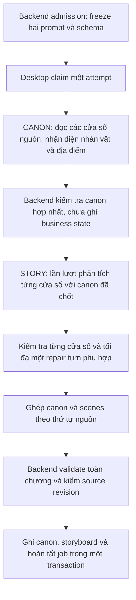

# Plan: Tách Chapter Analysis thành hai prompt

**Ngày:** 2026-10-17  
**Trạng thái:** PARTIAL — contracts, backend stage validation, Desktop runner và diagnostic metadata đã triển khai; PostgreSQL round-trip, runtime acceptance và benchmark chưa xác minh.  
**Phạm vi:** Hai mẫu prompt chạy tuần tự trong cùng một job: **CANON** (nhân vật và địa điểm), rồi **STORY** (cảnh, beat, hình ảnh và lời đọc).

## 1. Mục tiêu và phạm vi đợt đầu

Tách việc nhận diện thực thể khỏi việc dựng kịch bản để bước dựng cảnh không phải sinh lại mô tả nhân vật/địa điểm. Giữ danh mục tham chiếu nhất quán giữa các đoạn và giảm phần đầu ra lặp lại. Đây chưa phải bằng chứng đã giải quyết mọi lỗi giới hạn output: STORY vẫn có thể sinh nhiều VisualBeat và cần đo bằng chương thật.

- Giữ một thao tác **Phân tích chương**, một admission, một job, một attempt và một lần ghi kết quả cuối.
- Hai mẫu prompt không đồng nghĩa luôn có đúng hai lần gọi CLI. Chương vừa một cửa sổ chạy CANON → STORY; chương dài chạy hết cửa sổ CANON trước, rồi mới chạy các cửa sổ STORY.
- Giữ cách chia `sourceUnits` và ngưỡng hiện hành **6.000 ký tự** trong đợt này. Thử 2.500 ký tự và chia thích ứng là đợt sau, dựa trên số đo.
- Giữ trường tùy chỉnh Chapter Analysis hiện có trong Settings; backend ghép chỉ dẫn chung vào từng prompt theo phạm vi của stage. Chưa thêm hai ô cấu hình độc lập hay màn hình duyệt canon giữa chừng.
- Giữ model, sandbox, cơ chế đăng nhập, quota, timeout CLI hiện có và giới hạn chạy song song. Không thêm provider, dependency, broker hay service.

## 2. Hiện trạng đã đối chiếu

| Thành phần | IMPLEMENTED hiện tại | TARGET của plan |
|---|---|---|
| Resources `analysis/chapter-analysis/1.2/` | Một prompt/schema sinh cả `canon` và `scenes` | 1.2 được giữ cho snapshot cũ; resources 1.3 có prompt/schema CANON, prompt/schema STORY và schema final |
| `ChapterAnalysisContractResources` | Version 1.2, một prompt hash và schema hash | Version 1.3; hash composite cùng hash cho từng stage |
| `EnqueueStoryAnalysisUseCase` + `LocalAnalysisSnapshotCapture` | Resolve chỉ dẫn tùy chỉnh và capture execution snapshot lúc enqueue | Capture hai prompt/schema đã compose trong cùng admission; dispatch chỉ đọc snapshot |
| `LocalChapterAnalysis.Claim` / Desktop `AnalysisClaim` | Một `promptTemplate` và `responseSchema` | Typed stage bundle CANON/STORY; adapter v3 claim staged, adapter cũ chỉ claim legacy |
| Desktop `AgyRunner.run` | Phân tích tổng hợp theo cửa sổ; merge canon; kiểm tra và một repair turn | Legacy branch giữ nguyên; staged branch chạy tất cả CANON windows rồi STORY windows |
| Desktop `agy-windows.ts` | Cửa sổ theo câu; global unit indexes; compact canon; ghép kết quả | Thêm context definitions và merge staged canon có kiểm tra duplicate/conflict |
| Backend validation/materialization | Kiểm tra kết quả và ghi toàn chương trong transaction | Validation riêng cho CANON/STORY, kiểm reference và schema final trước materialize |
| Prompt Settings | Backend/API và freeze đã có; ADR-0010 còn **Proposed** | Giữ cấu hình chung hiện có; không coi UI/provider acceptance là đã hoàn tất |

`docs/current-status.md` đang thiếu dù documentation map còn liên kết tới nó. Plan này dùng code, migrations và các ADR đang tồn tại; không suy diễn trạng thái từ liên kết bị thiếu. Migration inventory hiện có V1–V7 và additive V17–V19; V18 lưu stage contracts để không sửa migration cũ. Worktree có nhiều thay đổi ngoài phạm vi; phải bảo toàn khi triển khai.

**Kết quả triển khai hiện tại:** backend compile; batch backend chọn 59 test, 54 đạt, một assertion baseline V7 có sẵn thất bại (`supportsSpeakingRate`) và bốn PostgreSQL/Testcontainers bị skip vì Docker pipe không truy cập được. Stage contract/resource, validator, service và migration regression mới đạt. 62 Desktop runner/window/service test đạt; full Desktop type-check và build đạt. Full test suite không hoàn tất do ba test quản lý tiến trình `agy-exec` trên Windows thất bại/chạy chậm. Browser fixture của Jobs hiển thị và copy được stage/window, với dark/light layout, empty state và log error đã kiểm tra. Electron cùng backend/PostgreSQL thật và inference acceptance chưa xác minh. Không có DB đang chạy để audit migration history; không reset database và chưa xác nhận installation đã áp dụng V18.

## 3. Luồng đề xuất

### Prompt 1 — CANON

- Input: ngôn ngữ nguồn, numbered source units; cửa sổ sau nhận danh mục đã tìm được để tái sử dụng `ai_name`.
- Output chỉ có `canon.characters` và `canon.locations`; không có scene, beat hoặc audio cue. Giữ các trường canon mà backend hiện cần: tên/mã, aliases, role/importance và visual prompt tương ứng.
- Mô tả dựa vào truyện; không tạo Character mới chỉ vì thay trang phục hoặc ngoại hình tạm thời. Việc resolve thành identity/ProjectCharacter/CharacterVersion vẫn do backend hiện có quyết định, không ghi trực tiếp từ stage này.
- Chương dài: hợp nhất theo mã chuẩn, hợp nhất aliases, phát hiện mã trùng/xung đột; không âm thầm ghi đè định nghĩa. Hết CANON mới sang STORY.
- Validate schema, enum, tên/mã, trường bắt buộc và giới hạn dung lượng. Mâu thuẫn nhận diện không giải quyết được phải báo lỗi; không dùng một canon rỗng thay cho output hỏng.

### Prompt 2 — STORY

- Input: chỉ source units của cửa sổ đang xử lý; canon context gồm mã, aliases và mô tả ngắn cần thiết; thông tin cảnh trước để giữ mạch.
- Output chỉ có `scenes`, bao gồm `visual_beats`, `visual_direction`, `audio_cues`, chỉ số nguồn và các tham chiếu nhân vật/địa điểm. Không sinh lại hoặc sửa `canon`.
- Chỉ dùng mã có trong canon đã qua kiểm tra. Mã không tồn tại trở thành lỗi validation; repair yêu cầu chọn đúng tham chiếu, không tự thêm thực thể sau stage CANON.
- Giữ global unit indexes, ranh giới cửa sổ, coverage, thứ tự, speaker và quy tắc `KEEP_EXACT`. Đoạn ngữ cảnh không được sinh lại lời đọc/beat.
- Dùng lại một repair turn trong conversation của cửa sổ STORY, có schema STORY. Sửa lỗi canon bằng stage CANON trước khi qua stage sau; không gửi yêu cầu sửa canon bằng schema STORY.

### Kết quả cuối

Desktop ghép thành hình dạng hiện tại: `{ "canon": { "characters": [], "locations": [] }, "scenes": [] }`. Đây chỉ là minh họa cấu trúc, không phải kết quả hợp lệ cho mọi chương. Backend vẫn kiểm tra toàn bộ coverage và materialize bằng pipeline hiện có. Không tạo luồng lưu nhân vật trước, beat sau.

## 4. Contract, lưu trữ và tương thích

- Đề xuất execution contract **1.3**, adapter **`antigravity-cli/3`**; final result giữ hình dạng 1.2. Backend xác định rõ schema của từng stage và schema cuối, không dùng schema tổng hợp cho mọi lượt.
- Stage bundle có đúng hai khóa `CANON`/`STORY`, mỗi khóa gồm instruction đã compose, response schema và hashes. Composite fingerprint bao gồm cả hai contracts, final schema, source revision và settings revision; không đổi fingerprint của snapshot cũ.
- Đề xuất thêm JSONB nullable chứa stage contracts trong execution snapshot; giữ các cột legacy để đọc job cũ. Tên cột/mapper phải chốt sau khi kiểm schema và immutability trigger thực tế. Không giấu stage contracts trong custom prompt text hay để Desktop tự chọn prompt đóng gói mới nhất.
- Job/snapshot 1.2 tiếp tục dùng luồng tổng hợp cũ. Job mới mới dùng hai stage. Không cập nhật lại snapshot immutable, không tự chạy lại job FAILED/UNKNOWN để chuyển phiên bản.
- Backend chỉ giao contract mới cho adapter hỗ trợ nó; Desktop mới đọc được contract cũ, Desktop cũ không được claim rồi chạy nhầm contract mới. Backend mới/Desktop cũ và chiều ngược lại phải có kiểm thử tương thích rõ ràng.
- Audit Flyway history trước khi sửa lưu trữ. Inventory hiện tại gồm baseline V1–V7 và additive V17–V19; migration V18 phải chạy trên clean database lẫn các installation đang có dữ liệu theo [database policy](../architecture/database.md). Không reset DB, rewrite snapshot hoặc repair checksum tự động.
- Custom instruction hiện có được freeze một lần và compose dưới quy tắc bảo vệ của từng stage. Chỉ dẫn như “tạo beat” không được khiến CANON trả scenes; không mất nội dung tùy chỉnh đã lưu.
- Kiểm byte budget trên payload thực gửi, gồm instruction, nguồn và canon context; không chỉ đếm source text. Kiểm giới hạn từng output và kết quả sau ghép, không cắt JSON cho vừa hạn mức.

## 5. Thực thi, lỗi và quan sát

- Giữ backend admission/lease/cancellation và journal trước external I/O. Cả hai stage thuộc cùng attempt; một chương vẫn chiếm một slot, không nhân đôi concurrency.
- Kết quả CANON tạm ở bộ nhớ trong attempt. Đợt đầu chưa thêm checkpoint để resume giữa stage; crash/đóng app dùng semantics `APP_INTERRUPTED` hiện có, không âm thầm chạy lại CANON hoặc STORY. Kết quả cuối vẫn ghi journal mã hóa trước delivery.
- Giữ `UNKNOWN` và không blind-resubmit. Repair chỉ áp dụng cho kết quả đã nhận và lỗi validation xác định; timeout/token limit không tự sinh một attempt mới.
- Ghi stage và cửa sổ vào metadata chẩn đoán để biết lỗi xảy ra ở đâu. Giữ redaction và không log nội dung truyện, model output hoặc credential.
- Cộng usage của CANON, STORY và repair đã được báo; giá trị không có giữ `null`, không biến thành zero. Tổng runtime bao phủ cả hai stage. Không dùng `conversationId` cuối như bằng chứng chỉ có một lượt inference.
- Progress tăng đơn điệu qua cả hai stage; chỉ completion backend đặt 100%. Nhãn stage do enum/logic tin cậy tạo, không lấy trực tiếp từ model. Phần ước lượng trong một lượt phải tiếp tục được phân biệt với milestone thực.

## 6. Các bước triển khai

Thực hiện lần lượt; mỗi bước code phải có regression cho hành vi thay đổi và chạy đạt trước khi tiếp tục. Đề xuất viết test contract/runner trước vì đây là thay đổi giao thức; đây không phải lựa chọn TDD đã được người dùng xác nhận.

### T01 — Chốt contracts và resources của hai prompt

**Files:** `app/backend-service/src/main/resources/analysis/chapter-analysis/1.3/` (mới), `.../infrastructure/analysis/ChapterAnalysisContractResources.java`, `.../application/model/analysis/ChapterAnalysisInstructions.java`, các test `ChapterAnalysisProfileContractTest` và `ChapterAnalysisInstructionsTest`.

- [x] Viết hai prompt/schema chuyên biệt và schema kết quả cuối; CANON không dựng cảnh, STORY không phát sinh canon.
- [x] Giới hạn: ai_name/name/aliases tối đa 160 ký tự theo cột identity; description tối đa 4.000, visual_prompt tối đa 8.000 theo payload và văn bản prompt. Giữ nguyên trường materializer cần và quy tắc timing.
- [x] Version/hashes 1.3 đầy đủ; giữ resources 1.2 cho snapshot cũ.
- [x] Test stage boundary, unknown fields, required fields, enum, độ dài, custom instruction, duplicate identity và conflict; backend stage validator tests đạt.

### T02 — Freeze, persist và giao đúng contract theo adapter

**Files:** `.../application/usecase/EnqueueStoryAnalysisUseCase.java`, `.../infrastructure/analysis/local/LocalAnalysisSnapshotCapture.java`, `.../application/model/analysis/ChapterAnalysisExecutionSnapshot.java`, `.../application/port/in/LocalChapterAnalysis.java`, `.../infrastructure/analysis/local/LocalChapterAnalysisService.java`, `.../api/controller/StoryAnalysisRuntimeController.java`; `.../infrastructure/persistence/adapter/MyBatisChapterAnalysisExecutionStore.java`, MyBatis snapshot row/mapper/XML; additive V18 and rollout audit.

- [x] Cột JSONB nullable `stage_contracts_json` được thêm bằng migration additive V18 theo inventory hiện tại; V4/V5 không bị sửa.
- [ ] Audit Flyway history và xác minh upgrade của installation hiện hữu; môi trường này không truy cập được PostgreSQL/Docker.
- [x] Capture hai prompt/schema và provenance trong admission transaction; claim/replay đọc snapshot đã lưu.
- [x] Typed stage contracts/capability gating; adapter cũ không claim snapshot 1.3; snapshot legacy 1.2 không bị rewrite.
- [x] PostgreSQL round-trip, immutable snapshot và queue compatibility regression đã viết; test queue/capability đã chạy trong service suite.
- [ ] PostgreSQL round-trip và migration apply còn pending vì Testcontainers bị skip do Docker pipe AccessDenied. Idempotency/settings-freeze coverage hiện có chưa được chạy lại trong lượt này.

### T03 — Backend kiểm tra stage riêng và kiểm tra cuối

**Files:** `.../application/port/in/LocalChapterAnalysis.java`, `.../api/controller/StoryAnalysisRuntimeController.java`, `.../infrastructure/analysis/local/LocalChapterAnalysisService.java`, validator/parser hiện được service gọi; các test `LocalChapterAnalysisServiceTest` và `ChapterAnalysisAtomicMaterializationIntegrationTest`.

- [x] Mở rộng validation read-only theo stage; request legacy tiếp tục dùng validation tổng hợp.
- [x] CANON không cần scenes/coverage; STORY kiểm canon, references và bounds theo cửa sổ; completion kiểm schema final.
- [x] Giữ participation, locked CharacterVersion, source revision fencing và transaction materialization hiện có; validation không ghi canon.
- [x] Unit tests cho duplicate/conflict và unknown character/location reference đạt; service suite kiểm tra stage/final validation.
- [ ] PostgreSQL rollback/stale-source integration matrix chưa chạy vì Docker không truy cập được.

### T04 — Desktop chạy CANON → STORY

**Files:** `app/desktop/src/main/story-analysis/{types,agy-runner,agy-windows,service}.ts`; test `agy-runner.test.mjs`, `agy-windows.test.mjs`, `story-analysis-service.test.mjs`, `agy-review-fixes.test.mjs`.

- [x] Typed stage contracts và nhánh legacy; mỗi lượt CLI nhận prompt/schema đóng băng theo stage.
- [x] Hoàn tất CANON trước STORY; các windows giữ global indexes và final canon bất biến trước STORY.
- [x] Repair dùng cùng conversation/schema stage; payload+schema được tính vào byte budget; usage giữ null khi một lượt thiếu metric; progress chia đơn điệu trên hai stage; diagnostics chỉ lưu lỗi đã redacted cùng stage/window.
- [x] 62 runner/window/service tests đạt: hai lượt chính cho chương ngắn, CANON barrier, alias merge, canon freeze, usage unknown, CANON/STORY repair, cancellation giữa stage, validation/progress transport và retry delivery.
- [x] Full Desktop type-check, build và runner/service regressions đạt; isolation/tool restriction có regression.
- [ ] Full Desktop test suite chưa hoàn tất: ba `agy-exec` process lifecycle tests thất bại/chạy chậm trên Windows và lượt chạy bị dừng trước summary.

### T05 — Xác minh runtime và acceptance

**Files:** fixtures/tests hiện có cho Chapter Analysis và Jobs; script/bằng chứng runtime cục bộ; file metadata/progress/diagnostics hiện có nếu cần mở rộng trường stage.

- [x] Jobs fixture hiển thị stage/window trong diagnostics; copy report giữ Job ID và stage/window. Browser kiểm tra dark/light, viewport 640px, empty state, log read error, console và network.
- [ ] Transport từ Desktop thật qua API/backend chưa xác minh; fixture regression chưa thay cho runtime API thật.
- [ ] Electron/Vite + backend thật: thực hiện Phân tích chương, thấy CANON rồi STORY, kết quả nhân vật/địa điểm/cảnh/lời đọc đúng nguồn; mở Jobs và xem/copy lỗi có stage khi gặp lỗi thật.
- [x] Fixture kiểm tra empty state, log read error, console/network và overflow; đã xem screenshot inline trong dark/light theme.
- [ ] Electron thật, đồng bộ renderer/main/preload và backend runtime chưa khởi động được trong môi trường này; runtime verification bị blocked.
- [ ] Chạy một chương ngắn và chương từng lỗi để đo số call, token nếu provider báo, tổng thời gian, output bytes và trạng thái cuối; không dùng fixture pass để kết luận inference thật thành công.
- [ ] Full gate backend/Desktop theo CONTRIBUTING chưa đạt: backend Testcontainers bị skip do Docker và một assertion V7 hiện có thất bại; Desktop full test suite chưa hoàn tất do `agy-exec` process tests. Không đánh dấu acceptance inference là IMPLEMENTED.

### T06 — Đồng bộ tài liệu và kết thúc

**Files:** [ADR-0009](../decisions/ADR-0009-chapter-analysis-agy-cli.md), [ADR-0010](../decisions/ADR-0010-installation-wide-prompt-settings.md) nếu thay đổi chi tiết freeze, [database](../architecture/database.md), [plan CLI](agy-cli-chapter-analysis.md), plan này.

- [x] Cập nhật flow hai stage, version/capability compatibility, snapshot và giới hạn; benchmark giữ pending.
- [x] Cập nhật migration inventory V17–V19 và kiểm tra các link mới cùng `git diff --check`; inventory khớp các file migration hiện có.
- [ ] Link checker còn ghi nhận các link cũ tới `docs/current-status.md` và một số tài liệu domain đang thiếu; tài liệu map đó chưa được khôi phục trong phạm vi plan này.
- [ ] Khi hoàn tất, xử lý plan theo quy tắc repo: xóa plan đã xong và giữ lịch sử trong Git; không tự commit/stage thay đổi ngoài phạm vi.

`.../` trong các Files block là `app/backend-service/src/main/java/com/narrativex/backend/feature/generation/`. Tên test chỉ nhóm test hiện có cần mở rộng; thêm test mới cạnh nhóm đó khi chưa có seam phù hợp.

## 7. Acceptance và giới hạn

Đạt khi job mới thực sự sử dụng hai prompt/schema khác nhau; STORY chỉ dùng canon đã kiểm; kết quả cuối giữ contract/source authority; failure/recovery không tạo lại inference ngoài quy tắc; job cũ giữ snapshot cũ; tests và runtime có bằng chứng tương ứng.

**DEFERRED:** hai trường Settings độc lập; UI duyệt canon giữa hai stage; thay ngưỡng 6.000 bằng 2.500; chia theo token/output budget; resume từ checkpoint giữa stage; parallel STORY trong cùng chương; tự động chạy lại sau timeout/token limit; cache và provider fallback.

Đánh đổi cần đo: thêm một giai đoạn làm tăng số lượt gọi và prompt overhead, CANON vẫn có thể vượt output với chương nhiều thực thể, và nhận diện thiếu ở CANON có thể làm STORY bị từ chối. Không cam kết giảm thời gian/quota hoặc hết lỗi output trước benchmark.

## 8. Kiểm tra khi triển khai và thao tác ngoài plan

Backend: `./mvnw.cmd test` tại `app/backend-service` (dùng build directory riêng nếu IDE đang compile). Desktop: `npm ci`, `npm test`, `npm run type-check`, `npm run build` tại `app/desktop`. Không thay generation-service nên không lấy test của nó làm bằng chứng cho luồng text analysis.

Live provider verification dùng session agy đang đăng nhập và tiêu hao quota; ghi rõ lượt chạy và dữ liệu mẫu. Việc nâng cấp installation có dữ liệu phải theo rollout đã audit, không mặc định DB disposable. Lượt implement này chưa gọi provider, nên chưa tiêu hao quota. Docker Desktop pipe trả AccessDenied; PostgreSQL round-trip bị skip và không có Flyway history installation để audit. Không reset database; acceptance cho installation hiện hữu và luồng inference thật còn pending.

## Tài liệu liên quan

- [ADR-0006 — Story structure và source anchoring](../decisions/ADR-0006-story-structure-and-source-anchoring.md)
- [ADR-0009 — Desktop agy execution](../decisions/ADR-0009-chapter-analysis-agy-cli.md)
- [ADR-0010 — Prompt Settings và admission freezing](../decisions/ADR-0010-installation-wide-prompt-settings.md)
- [Quy định kiểm tra của repository](../../CONTRIBUTING.md)
