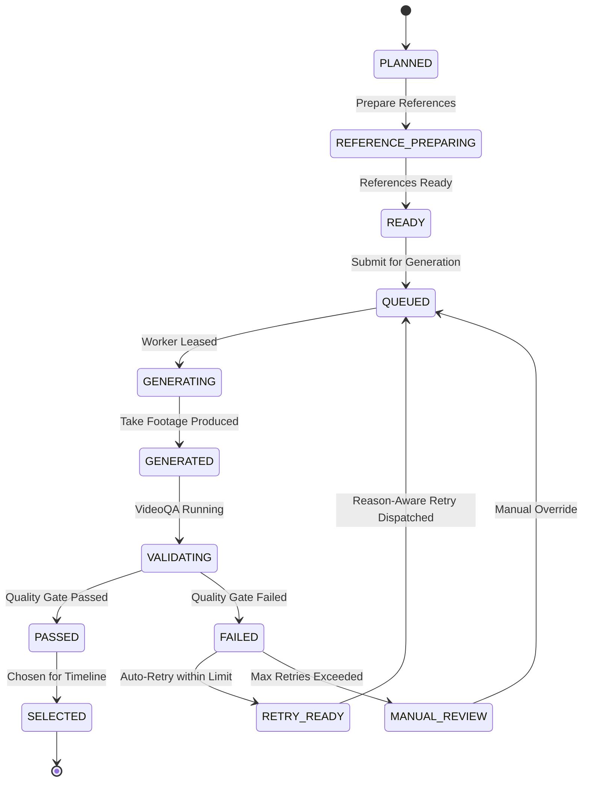

# Shot Domain Model

**Status:** Authoritative Domain Specification  
**Authority:** ADR-0027, ADR-0029, ADR-0030  
**Date:** 2026-09-20  

---

## 1. Shot as the Atomic Production Unit

A `Shot` is the definitive production unit in NarrativeX. It represents a continuous take generated by a video model, governed by camera movement, subject action, and temporal progression.

---

## 2. Entities & Schema

### ShotSequence
```typescript
interface ShotSequence {
  id: string;
  visualBeatId: string;
  orderIndex: number;
  shots: Shot[];
}
```

### Shot Aggregate
```typescript
interface Shot {
  id: string;
  sequenceId: string;
  orderIndex: number;

  narrativePurpose: string;      // Why this shot exists in the story
  retentionRole?: RetentionRole;

  subjects: SubjectRef[];
  locationRef?: string;

  startState: ShotState;        // Initial actor pose, composition, environment
  action: ShotAction;           // Specific kinetic activity occurring during the shot
  endState: ShotState;          // Resulting pose or composition at cut point

  composition: Composition;      // Shot size, framing, angle
  camera: CameraPlan;            // Lens, focal length, height
  
  subjectMotion: MotionPlan;     // Speed, direction of actor movements
  cameraMotion: MotionPlan;      // Pan, tilt, track, dolly, crane, static
  environmentMotion: MotionPlan; // Wind, rain, background extras, atmospheric particles

  targetDurationMs: number;      // Anticipated duration on timeline
  generationStrategy: GenerationStrategy;
  qualityProfile: QualityProfile;

  continuityFromShotId?: string; // Preceding shot ID for temporal continuity
  continuityToShotId?: string;   // Succeeding shot ID

  status: ShotStatus;
  selectedTakeId?: string;
}
```

---

## Durable Shot Admission (IMPLEMENTED)

`POST /api/v1/projects/{projectId}/shots/{shotId}/takes` requires `Idempotency-Key`.
The admission transaction locks the key and current Shot/Chapter, checks queue capacity,
and persists one PENDING Take, GenerationJob, scoped OperationPlan, StageAttempt and
outbox event. It performs no external submission. The response always supplies the
Take ID and public generation job ID (`generationJobId`, with `jobId` retained).
An identical replay returns that Take; changed inputs under the same key return 409.
A new regeneration key creates a new attempt, while UNKNOWN attempts require reconciliation.

Take persistence stores typed job/task/attempt/plan links and immutable
`inputSnapshotJson`/`inputFingerprint`. The snapshot freezes script/source revision,
shot inputs, real AudioCue text/delivery/status, participating locked CharacterVersions,
voice description/profile version, provider/model, configured workflow revision,
strategy, seed, deadline and audio mode. The current Native AV admission rejects
generation references, I2V and First/Last Frame before creating a Take, job or outbox
event because the active worker profile does not support artifact conditioning. A voice
description does not require reference-audio bytes while the profile does not consume
them. `sourceDurationMs` stays null until produced media is probed.

Queue admission uses the shared system capacity limit; waiting jobs do not occupy the
single video execution slot. Submission claims serialize that slot across SUBMITTING,
SUBMITTED, RUNNING, UNKNOWN and reconciliation/stalled states. An occupied slot leaves
the outbox event pending. Dispatch consumes only frozen Take inputs and creates expiring
artifact capabilities after commit; later Shot, voice or model edits cannot rewrite an
admitted attempt. Legacy non-shot dispatch remains supported.

New video Take admission accepts only `LTX_NATIVE_AV`; `AUDIO_FIRST` is rejected before
durable writes. Dispatch uses `video.generate:1.1` with explicit `audioMode = NATIVE_AV`
and does not repair missing frozen semantic fields. Runtime readiness requires the exact
worker task type, schema, model revision and Native AV profile. The active profile is
text-to-video at 1280x720/24 FPS/16:9; this readiness contract does not assert that a
GPU execution has been measured or is currently healthy.

---

## 3. Shot State Machine



### State Definitions
- `PLANNED`: Initial definition generated by Shot Director.
- `REFERENCE_PREPARING`: Collecting/generating character and location reference assets.
- `READY`: All inputs, prompts, and references validated; ready for GPU admission.
- `QUEUED`: Enqueued in backend control plane awaiting worker capability lease.
- `GENERATING`: Dispatched to GPU worker and actively executing on LTX-2.5.
- `GENERATED`: Footage received from worker; stored as candidate `Take`.
- `VALIDATING`: Passing through automated `VideoQA` checks.
- `PASSED`: Met all quality criteria; eligible for timeline inclusion.
- `FAILED`: Violated one or more QA criteria (with failure reason recorded).
- `RETRY_READY`: Ready for re-submission with adjusted prompt/parameters based on failure reason.
- `MANUAL_REVIEW`: Requires user review in Desktop editor (prompt edit, take pick, or strategy change).
- `SELECTED`: Active take bound to the `EditDecisionList`.
