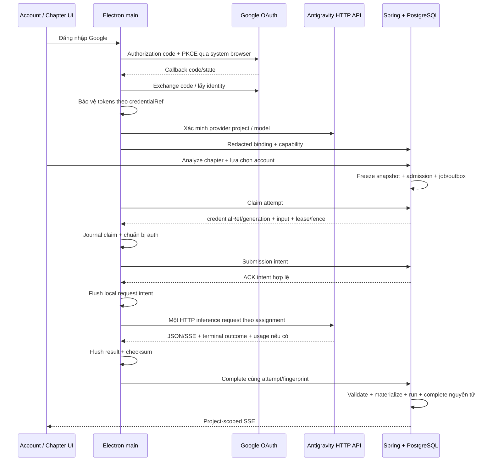

# Kế hoạch phân tích truyện qua Antigravity API và Google OAuth

> Proposal retained for reference. The user's later 2026-10-14 choice is the experimental
> [local CLI adapter in ADR-0034](../decisions/ADR-0034-local-antigravity-cli-chapter-analysis.md).
> The direct OAuth/API implementation and account pooling below remain TARGET, not current runtime.

**Ngày cập nhật:** 2026-10-14. **Phiên bản:** 3 — OAuth và HTTP API trực tiếp. **Trạng thái:** PARTIAL foundations / TARGET direct API; chưa triển khai hoặc kiểm chứng đăng nhập và inference thật.

**Yêu cầu đã xác nhận:** Người dùng đăng nhập Google từ NarrativeX, ứng dụng lấy kết nối account rồi gọi **API Antigravity trực tiếp qua Google OAuth**, theo mô hình kết nối của 9Router/Cockpit. Quản lý account vẫn nằm trong NarrativeX. Nhiều account, lựa chọn luân phiên và giới hạn chạy đồng thời tiếp tục thuộc mục tiêu của plan.

**Luồng được chọn:** `Account → Đăng nhập Google → OAuth callback → lưu credential được bảo vệ → lấy provider project/model → gọi Antigravity HTTP API → validate/materialize kết quả`.

Plan này thay thế phương án chạy binary `agy` của phiên bản 2. Không có bước cài/mở Antigravity IDE, đăng nhập trong Antigravity, đọc keyring/cache của Antigravity hoặc spawn CLI để phân tích. “API CLI” ở đây là giao thức HTTP phía provider; **Gemini CLI/Code Assist là provider path khác**, không tự thay vào scope này. Tên file cũ được giữ để các liên kết hiện có tiếp tục hoạt động.

Plan chỉ thay đổi thiết kế. Account screen hiện còn thông báo restriction và nút Connect bị disable; OAuth/API client chưa tồn tại. Nội dung TARGET không phải bằng chứng tính năng đã chạy.

## 1. Bằng chứng và điều kiện cần kiểm chứng

[Research OAuth/API](ANTIGRAVITY_OAUTH_API_RESEARCH.md) ghi nguồn và giới hạn lần đối chiếu này. Phương án cài/chạy binary CLI nằm ngoài hướng đã chọn.

| Nội dung | Bằng chứng từ nguồn | Chưa được chứng minh trong NarrativeX |
| --- | --- | --- |
| OAuth trong sản phẩm | 9Router có authorization code, token exchange, user info và provider onboarding | Client profile, scopes, callback và quyền truy cập tương thích với bản tích hợp |
| HTTP inference | Executor 9Router gọi `v1internal:generateContent` / `v1internal:streamGenerateContent?alt=sse` bằng Bearer token | Endpoint/header/model, structured output và response thực tế với account thật |
| Provider binding | Nguồn 9Router dùng `loadCodeAssist` / `onboardUser` lấy provider project/tier | Eligibility, onboarding và model của từng account; provider project khác Project NarrativeX |
| Native Google login | Google mô tả authorization code + PKCE và callback loopback cho desktop | Electron callback, cancel/timeout/restart và token storage trên Windows |
| Nhiều account | Token store có thể phân vùng theo credential | A/B độc lập khi refresh/reconnect/disconnect và inference đồng thời |
| Phạm vi hỗ trợ | Có implementation bên thứ ba để tham khảo giao thức | Đây chưa phải public API contract hay tích hợp được Google xác nhận hỗ trợ |

Điều khoản Antigravity hiện vẫn hạn chế truy cập dịch vụ bằng phần mềm bên thứ ba. Gọi HTTP trực tiếp không loại bỏ rủi ro này. Ghi provider support/policy riêng trong research và hồ sơ phát hành; không tuyên bố “officially supported” hoặc suy rằng OAuth thành công xác nhận quyền dùng subscription. Việc sửa plan tiếp tục theo transport người dùng đã chọn.

Các mốc kiểm chứng kỹ thuật của bản 3:

- **OAuth:** pin client profile/API adapter revision; kiểm client identity, scopes, redirect, exchange, refresh và provider binding. Google Sign-In thông thường không đủ chứng minh token dùng được cho Antigravity.
- **Một account:** đăng nhập từ Account, probe model, chạy một chapter thật, structured output hợp lệ và delivery/recovery đúng.
- **Nhiều account:** ít nhất A/B có identity/token binding độc lập, dedup đúng và backend thực thi limits.
- **Phát hành:** native UI evidence, quality gate, provider access classification và giới hạn vận hành được ghi rõ. Fixture không thay bằng chứng provider thật.

## 2. Hiện trạng và phần tái sử dụng

| Thành phần | IMPLEMENTED/PARTIAL trong worktree | TARGET bản 3 |
| --- | --- | --- |
| Account route | `/account`, entry Projects, return context, Settings link và restriction screen; workspace sidebar giữ các mục project | Account list, Google OAuth và trạng thái thực |
| Prompt/schema | Resources 1.1, hashes, typed input budget và nullable usage/provenance foundations | Reuse semantic schema; mapping/validation HTTP transport |
| Persistence | V13 metadata runtime/credential, execution snapshot/attempt và MyBatis store | API mode/checkpoint/provenance; kiểm applied history trước migration |
| Chapter Analyze | Admission, OperationPlan/job/outbox, Vertex handler/materializer | Route theo immutable snapshot; device execution qua API |
| Electron local execution | Machine pairing/transport và local render execution | Reuse identity/transport; analysis journal/capacity riêng |
| Provider OAuth/API | Chưa có vault, callback, direct API client hoặc registry API hoàn chỉnh | Triển khai T03–T10; chưa có kết quả real-account |

Baseline gốc: HEAD `d044b8608d76881dac3428a7a2f0dc62f6d5958c`, nhiều thay đổi chưa commit. Implementation phải đọc lại source/diff và giữ công việc khác. T01/T02 chỉ ghi nhận foundations, không chứng minh đã qua toàn bộ checks hoặc migrations đã apply.

Ranh giới theo [ADR-0018](../decisions/ADR-0018-backend-control-plane-and-domain-agnostic-gpu-execution-plane.md), [ADR-0019](../decisions/ADR-0019-generation-service-light-ddd-hexagonal-structure.md), [ADR-0020](../decisions/ADR-0020-single-user-local-first-architecture.md), [ADR-0021](../decisions/ADR-0021-submission-checkpoint-and-worker-recovery-semantics.md), [ADR-0022](../decisions/ADR-0022-vertex-gemini-chapter-analysis.md), [ADR-0025](../decisions/ADR-0025-event-driven-compute-orchestration-and-reconciliation.md), [ADR-0033 Proposed](../decisions/ADR-0033-direct-antigravity-api-with-desktop-google-oauth.md) và [Compute Protocol](../COMPUTE_PROTOCOL.md).

## 3. Ranh giới và luồng thực thi

| Lớp | Trách nhiệm |
| --- | --- |
| Renderer | Account UI, operation status, account/model selection, enqueue/status; DTO đã redaction |
| Preload | Typed connect/cancel/reconnect/disconnect/status events; validate sender; không expose token/URL tùy ý |
| Electron main | OAuth callback, protected tokens, refresh, binding/probe, HTTP client, execution journal và device transport |
| Spring + PostgreSQL | Desired config, opaque credential metadata, admission, selection, queue, lease/fence, retry policy và atomic materialization |
| GPU generation service | Giữ compute/media boundary; chapter analysis không đi qua worker |



Electron không tự quyết định business retry hoặc đổi account sau claim. Backend không nhận Google tokens. Provider protocol nằm ở main adapter, không vào backend domain.

## 4. Google OAuth và vòng đời account

1. **Account → Thêm tài khoản → Đăng nhập Google.** NarrativeX tạo operation ID và hiển thị tiến độ; không yêu cầu mở IDE/terminal hoặc nhập token thủ công.
2. Main tạo state ngẫu nhiên, PKCE S256, loopback listener trên cổng khả dụng và timeout. Trang Google authorization mở bằng system browser, callback tự trả kết quả về NarrativeX. Flow do NarrativeX khởi động/quản lý; không nhúng form mật khẩu Google trong renderer/webview.
3. Adapter dùng OAuth client profile tương thích Antigravity đã kiểm chứng: client identity, scopes, redirect và token exchange pin theo revision. Không giả định client Google Sign-In bất kỳ hoặc token Gemini CLI có cùng entitlement. Không ghi client secret/token thực vào docs, fixtures hoặc renderer bundle.
4. Main kiểm callback path/state/operation generation, exchange đúng verifier/redirect, lấy identity từ response xác thực và kiểm scopes được cấp. Nếu dùng ID token phải validate issuer/audience/nonce/expiry; decode đơn thuần không đủ.
5. Refresh token ở protected local store của main; access token giữ memory, chỉ persist khi cần và được bảo vệ. Phân vùng theo `credentialRef`, generation và client profile; atomic write/CAS chống callback/refresh cũ. Storage không khả dụng trả lỗi, không fallback plaintext.
6. Xác minh provider project, eligibility/tier và models. Onboarding là side effect của connect operation, có checkpoint trước I/O; mất response thì query/reconcile thay vì blind-repeat. Không tạo Google Cloud project/bật billing âm thầm hoặc sinh project ID giả.
7. Report opaque binding/capability về backend; chỉ báo đã lưu sau registry ACK. Phân biệt **Đã đăng nhập Google** với **Sẵn sàng phân tích**: token hợp lệ nhưng thiếu binding/model chưa ready.
8. Refresh single-flight/CAS riêng từng credential; giữ refresh token cũ nếu response không cấp token mới. Routine refresh không đổi identity/generation của attempt. `invalid_grant` chuyển AUTH_REQUIRED; job không tự mở browser để đăng nhập lại.

Dedup bằng provider identity đã xác minh, không dựa label/gói/email hiển thị. Cùng identity không tạo quota group/slot thứ hai. Raw Google subject/provider project và secrets ở main; backend chỉ cần opaque binding fingerprint/credentialRef. Account là provider connection theo ADR-0020, không trở thành User/Session/tenant NarrativeX.

Reconnect cùng identity có generation mới; binding khác tạo connection mới. Disable dừng assignment mới. Disconnect/retire drain active và UNKNOWN attempts trước xóa credential phục vụ recovery; run lịch sử giữ provenance. Google revoke có thể tác động toàn grant/client: kiểm chứng và hiển thị đúng scope. Reset layout/project export không mang hoặc xóa tokens/journal.

## 5. Direct API adapter và output

- `AntigravityApiClient` trong main gọi upstream HTTPS trực tiếp; host allowlist, API revision, headers, timeout và limits thuộc adapter. Renderer không cung cấp endpoint/headers/body tùy ý. V1 không cần 9Router sidecar hoặc local OpenAI-compatible proxy.
- Reference có `loadCodeAssist`, `onboardUser`, `generateContent`, `streamGenerateContent`; đây là dấu vết giao thức để spike. Pin source revision và sanitized fixtures. Không copy nhánh fake project ID, đổi fingerprint để né restriction hoặc automatic inference retries của router.
- Request dùng provider project đã xác minh, model thực, correlation ID, frozen input và validated generation config. Request ID chỉ dùng correlation đến khi upstream dedup được chứng minh; không tự coi là idempotency key.
- Chọn một kiểu inference đã kiểm chứng cho V1, JSON hoặc SSE. Parser kiểm envelope, terminal marker/finish reason, refusal/safety result, usage và structured JSON; HTTP 200 hoặc stream close chưa đủ. Bound bytes/frame/buffer; không thực thi tool/function calls trong output.
- Reuse prompt/schema 1.1. Map response schema nếu upstream hỗ trợ; nếu chỉ text JSON thì parse/validate cùng semantic schema và ghi capability đúng. Không giảm schema hoặc ngầm gọi pass sửa output thứ hai.
- Input budget EXACT/ESTIMATED/UNKNOWN theo tokenizer/API thực có; bound UTF-8 bytes/context đã benchmark. Không dùng Vertex countTokens/800k-token limit cho transport mới. Auto chia chương/merge nhiều pass là DEFERRED.
- Backend giữ exact anchors, source/canon revision, participating characters/speakers và immutable approved data. AudioCue mới vẫn DRAFT, không tạo narration timing chưa quan sát.
- Provenance mới: `ANTIGRAVITY_API`, `adapterVersion`, `apiRevision`, provider request ID nếu có, actual model/effort nếu quan sát, attempt/opaque credentialRef/hashes. Usage thiếu là nullable unknown. `cliVersion` chỉ còn legacy, không điền version giả cho API run.

## 6. Scheduler, concurrency và quota

Backend lưu desired config có revision. Defaults chỉ tác dụng job mới; giảm limits không kill run cũ. Khởi đầu đề xuất global/per-credential concurrency 1 và queue bound 20; đây là limits NarrativeX, không phải công bố Google.

```json
{
  "executionMode": "ANTIGRAVITY_API",
  "maxConcurrentAnalyses": 1,
  "defaultMaxConcurrentPerCredential": 1,
  "maxQueuedAnalyses": 20,
  "credentialSelection": "ROUND_ROBIN_READY",
  "automaticApiFallback": false
}
```

Claim trong short transaction: replay claimRequestId → lọc paired device/credential/model/generation mới, enabled/không drain → reserve slot → chọn pinned hoặc ready round-robin → persist assignment/lease/fence/cursor → trả response. Backend restart không reset fairness; lock order nhất quán. Queue bound tách execution slot nhưng giữ runtime ceilings và một active analysis trên mỗi chapter/revision.

`PINNED` không tự đổi account. `AUTO_READY` chỉ bật sau mốc nhiều account. Main dùng đúng assignment. Quota UNKNOWN cho phép concurrency bảo thủ; rate limit/exhausted lưu scope/model, observedAt và reset/retry time có bằng chứng. Không suy quota % từ token usage/tên gói hoặc inference “ping quota” ngầm.

429/401/5xx không tự cho phép inference retry. Chỉ rejection được chứng minh trước inference mới cho backend tạo attempt khác theo bounded policy. Không rotate account/model để vượt refusal/restriction/UNKNOWN. Materialization chapter độc lập dùng Project lock/CAS tránh nhân đôi canon; không giữ DB transaction khi gọi provider.

## 7. Durability, cancel và recovery

Persist operation/submission intent trước external side effect. Inference cần backend intent ACK hợp lệ và local request-intent đã flush. Refresh/probe thuộc credential lifecycle, không được phát sinh inference retry. Tắt automatic HTTP retry cho generation POST.

| Checkpoint TARGET | Ý nghĩa / xử lý |
| --- | --- |
| CLAIMED | Chưa có inference intent; có thể reject/cancel trước I/O với evidence |
| SUBMITTING | Backend/local intent bền vững; crash window có thể đã gửi request |
| REQUEST_IN_FLIGHT | HTTP request/stream đang mở; không tạo inference thứ hai |
| RESULT_READY | Result bytes/checksum đã journal; chỉ retry delivery cùng result |
| DELIVERED | Backend materialization/run/completion commit, ACK idempotent |
| REJECTED_BEFORE_EXECUTION | Non-execution được chứng minh; backend quyết định attempt mới |
| UNKNOWN | Có thể provider đã chạy; giữ fence/reservation đến reconcile |

AbortController/socket close/timeout/main crash/lease expiry không chứng minh cloud inference dừng. Nếu upstream thiếu read-only lookup, recovery chỉ replay result đã lưu hoặc giữ UNKNOWN với diagnostic/action rõ. Provider request ID không tự cung cấp lookup/dedup.

Journal giữ attempt/fingerprint, credentialRef/generation, adapter revision, correlation, checkpoint, result/hash và delivery state; không chứa tokens. Bound disk/output, ACL/retention theo storage policy. Disk full sau inference không thành “chưa chạy” để retry. Cleanup result sau ACK/retention; không xóa UNKNOWN khi đóng Project/reset cửa sổ.

Complete cùng semantic payload hash trả ACK, khác hash trả RESULT_CONFLICT. Recover chỉ rotate reporting lease/fence cho same attempt và cấp `DELIVER_STORED_RESULT / OBSERVE_EXISTING_EXECUTION / WAIT_FOR_RECONCILIATION`. Cancel-vs-complete có cùng lock/fence; cancel thắng thì không materialize result mới, chưa rõ upstream thì cancel pending/UNKNOWN.

## 8. Contracts, persistence và migration

Tên mới là TARGET. Source/migrations hiện vẫn có `ANTIGRAVITY_CLI`; sửa plan không thay enum/rows đang có.

- Thêm `ANTIGRAVITY_API` vào Java/shared contracts/SQL constraints; giữ provider `ANTIGRAVITY`. Snapshot cũ `VERTEX_API`/`ANTIGRAVITY_CLI` không đổi nghĩa theo defaults. Job thiếu snapshot giữ Vertex route; legacy CLI snapshot chưa có runner báo capability unavailable, không tự gọi API.
- Reuse V13 runtime/credential/snapshot/attempt store; thêm checkpoint/provenance cần thiết, không đổi meaning lịch sử `LOCAL_RUNNING`. Desired/observed state, generation/retirement tách nhau; unique active attempt, claim replay/CAS giữ nguyên.
- Tokens/auth code/PKCE verifier/raw Google subject/absolute paths không vào PostgreSQL/renderer/logs/export. Backend giữ opaque refs, labels, capabilities, observations/expiry và evidence revisions cần thiết.
- FK dùng internal `generation_jobs.id`, API dùng public `job_id`. BIGINT fence/observation sequence truyền decimal string. Backend verify authoritative snapshot và completion semantic hash.
- Inventory hiện V1–V13; kiểm applied history/freeze trước chọn migration. Forward migration số còn trống cho installed/applied schema; không đổi checksum file đã apply, reset DB hoặc backfill lịch sử thành provider mới. [DATABASE](../architecture/DATABASE.md) sở hữu policy.

| API/IPC TARGET | Hành vi |
| --- | --- |
| Existing `POST /api/v1/projects/{projectId}/chapters/{chapterId}/analysis-jobs` | Giữ Idempotency-Key/source đã save; thêm optional config revision/account selection vào snapshot/fingerprint |
| `GET/PUT /api/v1/analysis-runtime/config` | Desired config/revision/CAS qua backend transport |
| `GET /api/v1/analysis-runtime/credentials`; `GET/PATCH .../{credentialRef}` | Redacted metadata, desired label/enabled/cap/drain; không nhận tokens |
| `PUT /api/v1/local-devices/story-analysis-runtime` | Machine-auth observations, runtimeEpoch và monotonic sequence |
| `/api/v1/local-devices/story-analyses/claim` | claimRequestId replay; assignment/input/profile/lease/fence |
| `{jobId}/submission-intent`, `heartbeat`, `observation`, `complete` | Intent ACK trước request; typed result/hash; reject stale identity/fence |
| `{jobId}/execution`, `recover` | Same-attempt reconciliation/delivery, không resubmit |
| `storyAnalysis.connect/cancelConnect/reconnect/disconnect/status/subscribeStatus` | Narrow preload bridge cho OAuth lifecycle và safe events |

Device scope mới đề xuất `STORY_ANALYSIS_ANTIGRAVITY_API`; machine credential tách Google OAuth. Pin device contract version hỗ trợ API mode, reject client cũ trước claim. Không expose generic HTTP proxy/token getter/command runner/callback receiver cho renderer.

## 9. Checklist triển khai

Ký hiệu: `B` = backend `feature/generation`; `L` = `feature/localexecution`; `R` = backend resources; `BT/LT` = test packages tương ứng; `D` = `app/desktop/src`; `DT` = `app/desktop/test`; `C` = `packages/client-contracts/src`. File mới là đề xuất; reuse seam đúng trách nhiệm nếu đã có. Mỗi task code cần tests success/error/race phù hợp; ô chưa tick chưa hoàn thành.

### T00 — Khóa hợp đồng OAuth/API và ADR

**Files:** Plan này; `ANTIGRAVITY_OAUTH_API_RESEARCH.md`; ADR-0033; evidence mới dưới `documentation/reviews/`.

- [x] Cập nhật scope theo xác nhận 2026-10-14: API Antigravity trực tiếp bằng Google OAuth do NarrativeX quản lý.
- [x] Đối chiếu nguồn OAuth/API 9Router và desktop OAuth; giữ CLI evidence cũ là lịch sử.
- [ ] Pin source/adapter/client profile, scopes, host/header/envelope/models; ghi access classification và contract chưa rõ.
- [ ] Ghi sanitized OAuth/onboarding/inference/refresh evidence; chưa chạy account thật trong lần sửa plan.
- [ ] Review ADR-0033 Proposed trước bật boundary mới; không sửa Accepted ADR-0022.

### T01 — Typed contracts và shared prompt/schema

**Files:** `B/application/model/analysis/*`, domain enums, `C/story-analysis.ts`, `R/analysis/chapter-analysis/1.1/*`; profile contract tests.

- [x] Foundations bản 2: shared schema/prompt 1.1, hashes, typed input budget và nullable usage.
- [ ] Thêm API mode, REQUEST_IN_FLIGHT, OAuth/provider errors, adapter/API provenance và redacted operation types; giữ legacy decoding.
- [ ] Map schema/effort theo capability; test parity, unknown metrics, Unicode, invalid model/effort và legacy profiles.
- [ ] Chạy targeted contract tests/typecheck khi implementation; checks cũ không chứng minh API mode.

### T02 — Persistence và migration tương thích

**Files:** `ChapterAnalysisExecutionStore`, MyBatis adapter/mapper/XML, migrations/run repository; PostgreSQL integration tests.

- [x] Foundations V13 runtime/credential/snapshot/attempt store và nullable usage/provenance; chưa xác minh applied history.
- [ ] Migrate constraints/checkpoints/API provenance theo mục 8; giữ old snapshots và internal/public ID mapping.
- [ ] Test API/Vertex/legacy CLI round-trip, unique attempts, CAS/fence, claim replay, retirement và migration compatibility.
- [ ] Chạy PostgreSQL/migration checks thật; cập nhật DATABASE/inventory khi schema đổi.

### T03 — Runtime config và credential registry API

**Files:** `B/api/controller/AnalysisRuntimeController.java`, `B/application/service/AnalysisRuntimeService.java`, local-device reporting; reuse T02.

- [ ] Config/list/PATCH metadata và device observations; desired/CAS tách readiness.
- [ ] Validate generation, duplicate binding, epoch/sequence/expiry, limits/model và drain/retire.
- [ ] Test stale report/save, duplicate registration, reconnect mismatch, unresolved attempts và redaction.
- [ ] Chạy backend API/service tests; không tạo application account identity.

### T04 — Snapshot, admission và dispatch

**Files:** `EnqueueStoryAnalysisUseCase`, command/request/profile, admission và dispatchers; enqueue/dispatcher tests.

- [ ] Freeze mode/model/effort/selection/config/source/prompt/schema cùng OperationPlan/job/outbox.
- [ ] Replay dùng frozen snapshot; input/options khác conflict; tách queue bound/execution slots.
- [ ] API mode thành durable device-pending, exactly one executor; không route cùng job sang Vertex/GPU.
- [ ] Test source/default change, old jobs, pinned selection, outbox replay và full slots; chạy targeted suite.

### T05 — Claim, scheduler và device endpoints

**Files:** `L/api/controller/LocalStoryAnalysisController.java`, `L/application/usecase/LocalStoryAnalysisUseCase.java`, `B/application/service/ChapterAnalysisSchedulingPolicy.java`; LT/BT/PostgreSQL tests.

- [ ] Claim replay/atomic assignment, API capability và intent/heartbeat/observation/execution/recover; complete nối T08.
- [ ] Persist cursor/slots/fence, enforce generation/UNKNOWN; main không tự chọn account.
- [ ] Test concurrent/lost-response claim, bounds, stale lease/device, capability mismatch và pinned unavailable.
- [ ] Chạy API/integration checks; không copy render retry policy sang generation POST.

### T06 — OAuth, protected tokens và Antigravity API client

**Files:** Create `D/main/story-analysis/google-oauth.ts`, `oauth-token-store.ts`, `credential-registry.ts`, `antigravity-api-client.ts`, `antigravity-result-parser.ts`, `antigravity-capabilities.ts`; reuse protected-secret primitive nếu có. Tests `DT/story-analysis-oauth.test.mjs`, `story-analysis-credentials.test.mjs`, `story-analysis-api.test.mjs`.

- [ ] Authorization code + PKCE/state/loopback, cancel/timeout/late callbacks; atomic per-credential vault và refresh single-flight.
- [ ] Verify identity/provider binding/models; checkpoint onboarding; duplicate login không tăng capacity.
- [ ] Bounded HTTPS inference/client profile/hosts/errors/JSON hoặc SSE parser; không automatic generation retry hoặc tool execution.
- [ ] Test wrong state/verifier/identity, thiếu scopes/refresh, invalid_grant, storage failure, redirects/hosts, truncated streams, refusal/output limit.
- [ ] Chạy Desktop tests/typecheck; fixtures không chứng minh live OAuth.

### T07 — Device service và journal trước HTTP request

**Files:** `D/main/story-analysis/service.ts`, `execution-journal.ts`, `backend-client.ts`; bootstrap/device integration; `DT/story-analysis-recovery.test.mjs`.

- [ ] Claim → validate input/binding → chuẩn bị auth → intent ACK → local flush → một HTTP inference; result journal trước delivery.
- [ ] Recovery chỉ stored result/read-only observation; timeout/restart không blind-resubmit; bounded disk/retention/sequence.
- [ ] Test crash boundaries, ACK loss, disk full, refresh race, backend offline và stale fence.
- [ ] Chạy recovery/service tests; journal không là business authority.

### T08 — Finalization và atomic materialization

**Files:** Analysis handler/materializer/run repository và common finalizer; backend materialization/integration tests.

- [ ] Verify result/hash/lease/attempt/source/canon/schema; một transaction materialize/run/complete.
- [ ] Same completion idempotent, khác payload conflict; DB retry cùng result; invalid output không inference lại.
- [ ] Test concurrent canon, stale source, anchors/speakers, cancel race, nullable usage và immutable data.
- [ ] Chạy backend tests; không partial scenes/cues hoặc fabricated timing.

### T09 — Reconcile/cancel/UNKNOWN

**Files:** Backend analysis reconciliation/cancel; T07 journal/service; recovery tests.

- [ ] Dedicated API-analysis reconciliation; GPU reconciler bỏ qua API/legacy CLI snapshots.
- [ ] Expose cancel pending/UNKNOWN/delivery pending; giữ binding/fence/reservation khi chưa rõ outcome.
- [ ] Test thiếu upstream lookup, lease expiry, late response, recover fence rotation, terminal replay và disconnect unresolved.
- [ ] Chạy failure-mode tests; ghi giới hạn cloud recovery khi thiếu lookup.

### T10 — Account UI, preload và Chapter selection

**Files:** Typed preload/bootstrap, `D/renderer/features/accounts/*`, `ChapterSourceStage`, generation API/queries; theo [Account plan](ACCOUNT_TAB_IMPLEMENTATION_PLAN.md).

- [ ] OAuth operation bridge và backend registry/default selection; thay restriction-only placeholder bằng connect flow thật.
- [ ] List/detail/login/model/quota freshness/default/pinned states; readiness theo observations thực.
- [ ] Test sender/redaction, route/return context, form/operation races và Analyze snapshot.
- [ ] Electron/browser automation mọi flow bị ảnh hưởng, real APIs/console/loading/error/empty/overflow/screenshots; native gate unavailable ghi runtime-verification blocked.

### T11 — Nghiệm thu một account thật

**Files:** Opt-in `DT/story-analysis-live.test.mjs`, sanitized evidence dưới `documentation/reviews/`; status/plan.

- [ ] Account → Google login → binding/model/default → chapter Analyze → dữ liệu thật/provenance → reload.
- [ ] Verify refresh/quota/refusal/schema/usage/delivery failure; không fallback API key/Vertex/credits.
- [ ] Ghi client/adapter/API revision, limits và native screenshots; không đưa secrets/truyện riêng vào repo.
- [ ] Nghiệm thu một account riêng; không tick nhiều account từ kết quả này.

### T12 — Nhiều account và concurrency

**Files:** T03/T05/T06 scheduler/vault, Account capabilities; isolation/opt-in throughput tests.

- [ ] A/B độc lập token/identity/binding; refresh/reconnect/logout A không đổi B; kiểm grant-wide revoke scope.
- [ ] Bật account thứ hai/manual pin/AUTO_READY; backend bounds, nâng concurrency bằng benchmark.
- [ ] Test duplicate identity, all exhausted, stale quota, two projects, pinned drain và UNKNOWN không rotate/resubmit.
- [ ] Đo cùng corpus: queue wait, p50/p95 latency, schema/UNKNOWN errors/throughput; pool chưa kiểm chứng vẫn PARTIAL.

### T13 — Rollout, docs và completion gate

**Files:** Plans, CURRENT_STATUS/README, ADR-0033, DATABASE/inventory nếu schema đổi; workflow/operations liên quan.

- [ ] Full `pwsh -File scripts/verify-local.ps1` trước push/merge; scoped backend/Desktop/contract checks khi implementation.
- [ ] Native UI/account/API evidence và acceptance criteria đạt; không lấy build/fixtures thay flow thật.
- [ ] Rollout opt-in API mode cho job mới sau runtime evidence/ADR review; rollback ngừng admission mới, giữ journals/snapshots/UNKNOWN recovery.
- [ ] Cập nhật IMPLEMENTED/PARTIAL/TARGET/DEFERRED; docs drift/links/inventory/whitespace pass; không rewrite in-flight jobs.

**Phụ thuộc:** T00 → T01/T02 → T03/T04/T06 → T05/T07 → T08/T09 → T10/T11 → T12 → T13. Contract/UI có thể chuẩn bị trước live-account evidence; inference/pool chỉ tick khi chạy thật. Không yêu cầu sub-agent hoặc worktree mới.

## 10. Nghiệm thu và phạm vi còn lại

1. Google login bắt đầu tại Account, callback tự về NarrativeX; không dependency binary/phiên Antigravity IDE/CLI.
2. Main bảo vệ tokens và gọi đúng Antigravity account/model/binding; backend chỉ opaque metadata và business authority.
3. Một account phân tích chapter thật, schema/domain/provenance đúng; usage/quota/model chưa quan sát thì unknown.
4. Hai account độc lập, round-robin/concurrency kiểm chứng riêng; limits có tác dụng, UNKNOWN không gây inference lặp.
5. Restart/mất ACK/cancel/source change không double-submit/materialize/apply stale result; giữ immutable data.
6. Full gate/native UI evidence trước merge; access/support classification của provider đúng bằng chứng.

**DEFERRED:** public OpenAI-compatible proxy, phụ thuộc dịch vụ 9Router, tự mua credits/bật billing, Gemini CLI/API-key migration, auto model fallback, tự chia chương/merge nhiều pass, scheduling theo tiền, broker/business service mới.

**Giới hạn lần sửa plan:** Chỉ tài liệu và ADR Proposed; chưa đổi UI/runtime/contracts/migration, chưa đăng nhập hoặc gọi provider thật. Inventory vẫn V1–V13. [Account plan](ACCOUNT_TAB_IMPLEMENTATION_PLAN.md) sở hữu UX/login lifecycle; plan này sở hữu execution/scheduler/durability/materialization.
